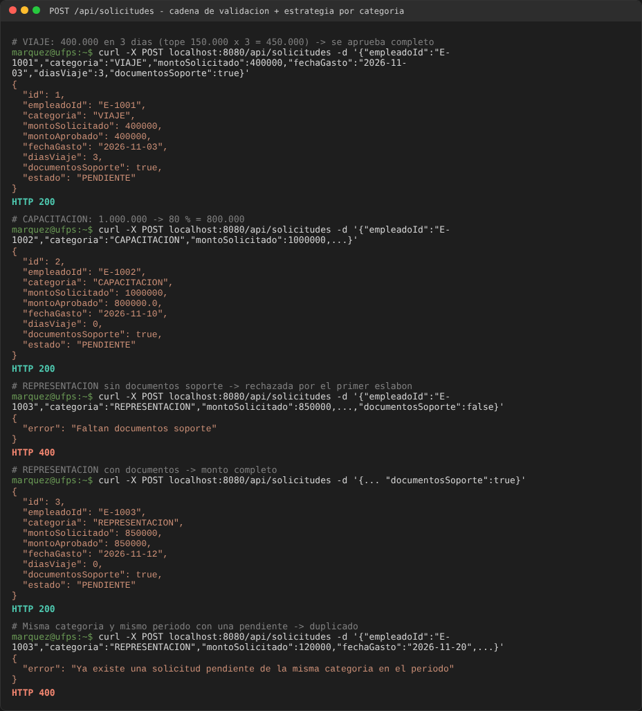
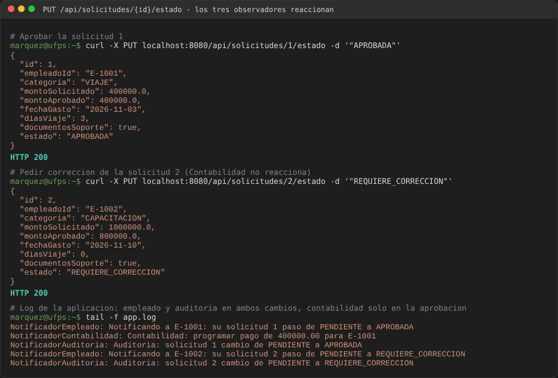
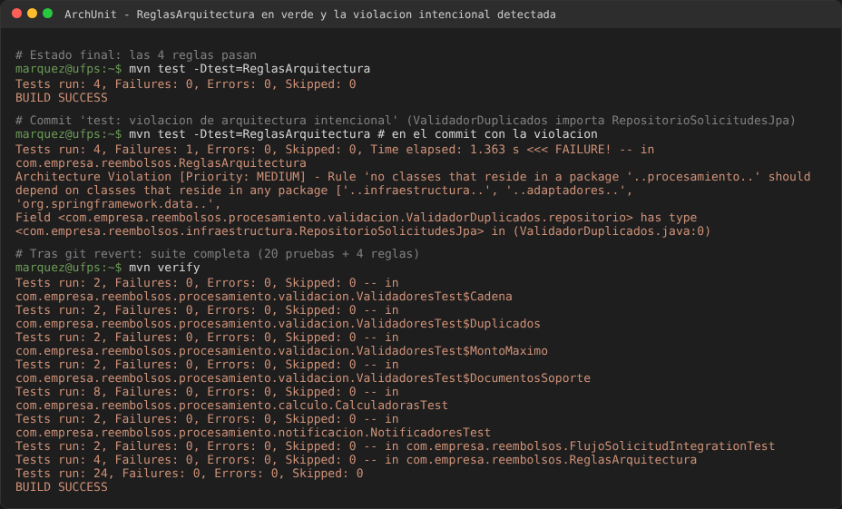

# Reembolsos Integrado — Proyecto Integrador

**Universidad Francisco de Paula Santander — Ingeniería de Sistemas**
**Curso:** Patrones de Diseño de Software (1156701-A) — Post-contenido Unidad 12
**Estudiante:** Diego Armando Márquez Rigaud — **Código:** 1152115

Sistema de solicitudes de reembolso de gastos corporativos que reemplaza la hoja de cálculo compartida del
área de Finanzas.

## Diseño Propuesto

Escrito **antes** de implementar cualquier patrón, a partir de los tres requisitos funcionales.

| Requisito | Qué varía (punto de variabilidad) | Patrón propuesto | Justificación (test de explicabilidad) |
|---|---|---|---|
| **RF1** — Validación en varias etapas | El **conjunto y el orden** de verificaciones que debe superar una solicitud (hoy tope por categoría, documentos soporte y duplicados; mañana un límite anual acumulado) | **Chain of Responsibility** | Cada verificación es un eslabón independiente que rechaza o pasa la solicitud al siguiente, así que agregar una verificación es crear un eslabón y enlazarlo, sin tocar los existentes. |
| **RF2** — Cálculo distinto por categoría | La **fórmula** del monto aprobado, elegida una sola vez por la categoría (tope diario × días, monto hasta tope mensual, 80 % hasta tope anual; mañana "bienestar") | **Strategy** (+ registro de estrategias por categoría) | Cada categoría calcula el mismo tipo de resultado con un algoritmo propio e intercambiable, sin estado ni orden entre ellas, que es exactamente lo que encapsula Strategy. |
| **RF3** — Notificación simultánea a varios interesados | **Quién** reacciona a un cambio de estado y **cómo** (empleado: siempre; Contabilidad: solo aprobaciones; auditoría: todo; mañana un panel de métricas) | **Observer** | El servicio publica "la solicitud cambió de estado" a una lista de observadores con reacciones propias, de modo que sumar un interesado no modifica al servicio ni a los demás. |

Descartados en este análisis: **State** para el ciclo de vida de la solicitud (los requisitos no definen
transiciones con reglas propias entre estados, solo notificar el cambio) y **Template Method** para las
calculadoras (no comparten un esqueleto de algoritmo, solo la firma).

Modelo de dominio (`dominio/`): `SolicitudReembolso`, `CategoriaGasto`, `EstadoSolicitud`, sin imports de
Spring ni de JPA.

## Decisiones de diseño (Parte 1)

1. **Orden de la cadena: documentos → monto → duplicados.** El eslabón más caro es `ValidadorDuplicados`
   (recorre la lista de pendientes que el servicio cargó de la base de datos); los otros dos son
   comparaciones O(1) sobre la propia solicitud. Ubicándolo **último**, una solicitud sin soportes o con un
   monto fuera de tope se rechaza sin recorrer la lista. Se pierde solo que, si hay varios problemas, el
   empleado ve primero el más barato de detectar y no el de duplicado (la cadena reporta el primer rechazo).
2. **Selección de calculadora con un mapa construido desde `List<CalculadoraReembolso>`** (inyectada por
   Spring con todos los `@Component`), no con un `switch` manual. RF2 exige agregar categorías sin modificar
   el código existente: con el mapa, "bienestar" es una clase nueva `CalculadoraBienestar` y una constante
   en `CategoriaGasto`; ni `SelectorCalculadora` ni las otras calculadoras cambian. El `switch` obligaría a
   editar el selector en cada categoría nueva (y el compilador no avisa si se olvida un caso con `default`).

Pruebas de la Parte 1: 20 (validadores, cadena, calculadoras, selector, notificadores y 2 de integración
`@SpringBootTest` con MockMvc, H2 y `@SpyBean` sobre los tres observadores).

Detalles de implementación relevantes:

- **Dominio sin JPA con `JpaRepository` directo:** el enunciado pide ambas cosas a la vez. Se resolvió
  declarando el mapeo en `src/main/resources/META-INF/orm.xml`; `SolicitudReembolso` no tiene anotaciones.
- **Tope de viajes coherente:** `ValidadorMontoMaximo` usa el tope de viajes como **diario** (150.000 ×
  días), igual que `CalculadoraViaje`; con un tope fijo de 150.000, un viaje de 3 días por 400.000 se habría
  rechazado aunque la fórmula de RF2 lo aprueba completo.
- **Período = mes y año:** `ValidadorDuplicados` compara `YearMonth`; comparar solo el mes trataría como
  duplicada una solicitud de noviembre de 2025 frente a otra de noviembre de 2026.

## Decisiones de diseño (Parte 2)

3. **Persistencia en capas simples y notificación sin cambios** — documentada en
   [`docs/adr/ADR-001.md`](docs/adr/ADR-001.md). Resumen: el criterio de la guía (sección 6.2) para
   Hexagonal —vida útil larga **con cambios de infraestructura**— no se cumple para la persistencia (no hay
   ningún plan de cambiar de motor), así que `SolicitudReembolsoService` sigue usando
   `RepositorioSolicitudesJpa` directamente. Para la notificación sí hay un cambio con fecha (la API de
   Contabilidad el próximo trimestre), pero `ObservadorCambioEstado` ya es el punto de extensión: bastará con
   cambiar `NotificadorContabilidad` o agregar un observador, sin tocar el servicio. Consecuencia negativa
   aceptada: si algún día cambia el motor, el puerto se introducirá de forma retroactiva.
4. **La Regla 1 prohíbe Spring Data, JPA, infraestructura y adaptadores, pero no todo `org.springframework`.**
   Las anotaciones de estereotipo (`@Component`) solo declaran que la clase es un bean: no acoplan la lógica a
   ninguna tecnología de entrada/salida, no cambian el comportamiento y se pueden instanciar con `new` en las
   pruebas unitarias (como hacen `ValidadoresTest` y `CalculadorasTest`). Lo que sí ataría la lógica de
   negocio a un detalle técnico es depender de repositorios, entidades JPA o clases web: eso haría que validar
   un monto requiera una base de datos o un contexto HTTP. Prohibir todo `org.springframework` obligaría a
   registrar cada validador, calculadora y notificador a mano en una clase `@Configuration`, con más código y
   ningún beneficio real para este proyecto.

Ajustes a las reglas del enunciado, encontrados al ejecutarlas: la Regla 2 incluye el propio paquete
`..adaptadores.rest..` (ArchUnit cuenta como "acceso" que el controlador lea su propio campo `servicio`), y la
Regla 3 filtra las clases cuyo nombre empieza por `Calculadora`, porque `SelectorCalculadora` vive en el mismo
paquete y no es una estrategia. Además se configuró surefire para que `mvn verify` también ejecute
`ReglasArquitectura` (su nombre no termina en `Test`).

### Integración continua

`.github/workflows/arquitectura.yml` ejecuta primero `mvn test -Dtest=ReglasArquitectura` y luego
`mvn verify` en cada push a `main`. El historial incluye el commit **`test: violacion de arquitectura
intencional`** (`ValidadorDuplicados` con un campo `RepositorioSolicitudesJpa`), cuyo pipeline falla en el
paso de reglas por `procesamientoSinPersistenciaNiWeb`, seguido de **`Revert "test: violacion de arquitectura
intencional"`**, con el pipeline de nuevo en verde. Ver la pestaña **Actions** del repositorio.

## Evidencia

**Creación de solicitudes: cálculo por categoría y rechazos de la cadena**


**Cambio de estado: los tres observadores**


**Reglas de arquitectura y suite completa**


## Qué se descartó y por qué

Criterio (guía, sección 4.2): ¿la variabilidad que justificaría la alternativa es real y documentada hoy, o
es especulación sobre un futuro que aún no llegó?

1. **`ApplicationEventPublisher` + `@EventListener` en vez de `List<ObservadorCambioEstado>` inyectada.**
   Con tres observadores fijos y conocidos en compilación, un bus de eventos genérico no aporta
   desacoplamiento real (ya lo da la interfaz) y sí dificulta rastrear quién reacciona a qué cambio.
   *Reconsiderar si:* un observador necesita ejecutarse después del commit o de forma asíncrona
   (`@TransactionalEventListener`), por ejemplo con la API de Contabilidad.
2. **Visitor o Abstract Factory para exportar reportes en varios formatos.** Solo existe el requisito de CSV;
   no hay una segunda solicitud real (no se cumple la Rule of Three). *Reconsiderar si:* Contabilidad pide
   formalmente un segundo y un tercer formato.
3. **(Propio) Una jerarquía de excepciones por validador** (`DocumentosFaltantesException`,
   `MontoExcedidoException`, `SolicitudDuplicadaException`) en lugar de `ResultadoValidacion` + una sola
   `SolicitudInvalidaException` con el motivo. Se consideró para que el controlador devolviera códigos
   distintos por tipo de rechazo. Se descartó: hoy los tres rechazos se tratan igual (HTTP 400 con un mensaje
   para el empleado) y nadie consume el tipo de error; tres clases más solo moverían el texto del motivo a
   nombres de clase, y además obligarían a los eslabones a lanzar excepciones como control de flujo, rompiendo
   el contrato "aprobar o pasar" de la cadena. *Reconsiderar si:* un cliente (por ejemplo, el frontend o la API
   de Contabilidad) necesita reaccionar programáticamente distinto según el motivo; entonces bastaría agregar
   un código enumerado a `ResultadoValidacion`, sin jerarquía de excepciones.
4. **(Propio) Un puerto `RepositorioSolicitudes` "por simetría" con Hexagonal.** Es la alternativa evaluada en
   ADR-001: sin un cambio de motor previsto, sería una interfaz con una sola implementación posible.
   *Reconsiderar si:* aparece una segunda fuente de datos o una migración de motor.
5. **(Propio) Anotar el dominio con `@Entity`.** Era lo más rápido para que `JpaRepository` funcionara, pero
   habría roto el requisito de un dominio sin JPA; se resolvió con `META-INF/orm.xml`, que no agrega
   indirección en el código Java.

## Cómo ejecutar

```bash
mvn clean verify                          # 20 pruebas + 4 reglas de arquitectura
mvn spring-boot:run                       # http://localhost:8080
mvn test -Dtest=ReglasArquitectura        # solo las reglas de ArchUnit
```

```bash
curl -X POST localhost:8080/api/solicitudes -H "Content-Type: application/json" \
     -d '{"empleadoId":"E-1001","categoria":"VIAJE","montoSolicitado":400000,"fechaGasto":"2026-11-03","diasViaje":3,"documentosSoporte":true}'
curl -X PUT localhost:8080/api/solicitudes/1/estado -H "Content-Type: application/json" -d '"APROBADA"'
```

## Herramientas utilizadas

- Java 17, Spring Boot 3.3 (Web, Data JPA), H2, mapeo JPA en XML
- JUnit 5, Mockito (`@SpyBean`), MockMvc, ArchUnit 1.2
- Apache Maven, GitHub Actions, Git, GitHub

## Conclusiones

Este proyecto se diseñó al revés que los laboratorios anteriores: primero se identificó qué variaba en cada
requisito y solo después se eligió el patrón. Así, cada patrón quedó justificado por una variabilidad real —el
conjunto de verificaciones (Chain of Responsibility), la fórmula por categoría (Strategy) y los interesados en
un cambio de estado (Observer)— y agregar una verificación, una categoría o un interesado es crear una clase
sin modificar las existentes. En la Parte 2, la pregunta más útil no fue "¿qué arquitectura es mejor?", sino
"¿qué cambio de infraestructura es real?": eso llevó a no introducir un puerto de persistencia y a reconocer
que la notificación ya estaba preparada. ArchUnit y el pipeline convierten esas decisiones en reglas que se
verifican en cada push, como mostró la violación intencional.
